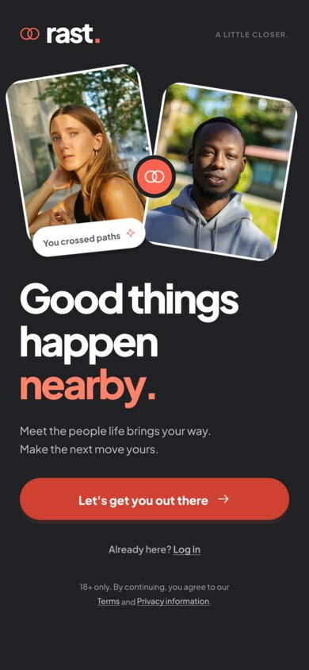
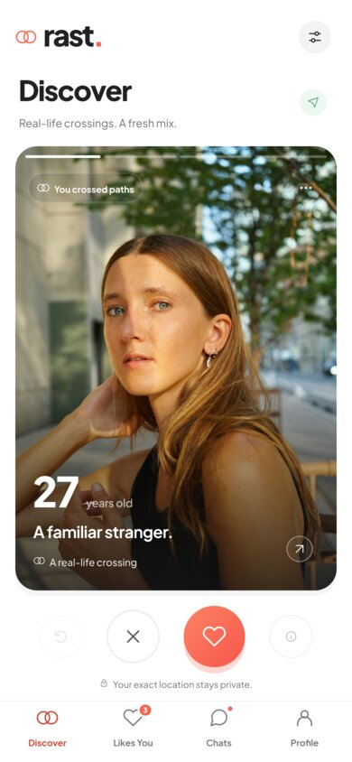
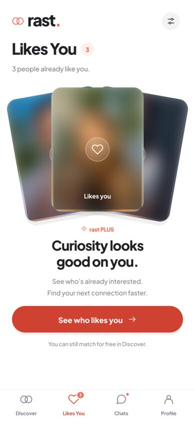
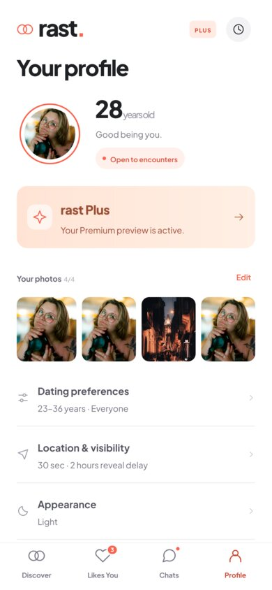
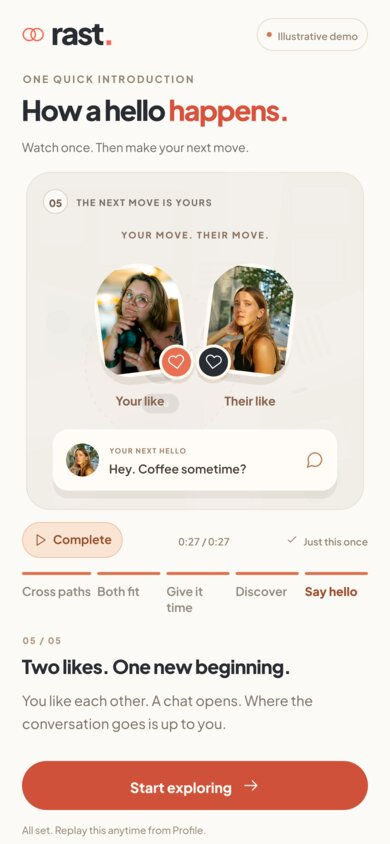
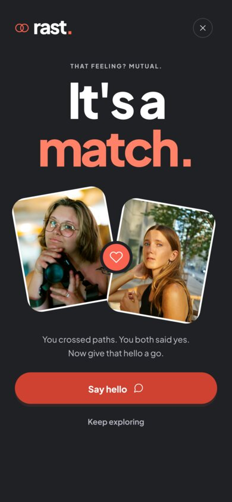
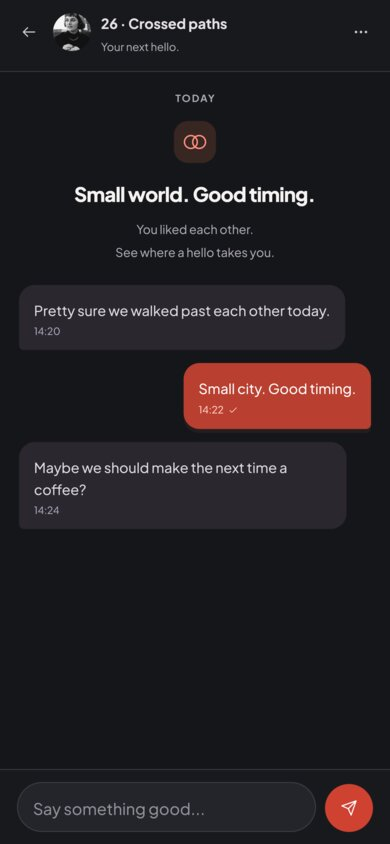
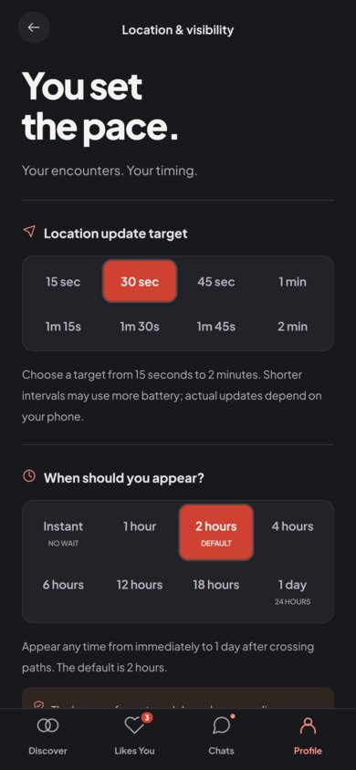

# rast

**Good things happen nearby.**

rast is a native, English-language dating app for iOS and Android, built with Flutter and Dart. Instead of endless browsing, rast shows you people whose paths actually crossed yours in real life: within about 20 metres, after a privacy delay, and only when you fit each other's preferences.

> Status: **milestone 1 done (2026-10-20)**: a fully navigable native app on mock data, light and dark, with 85 passing tests. Real SMS verification, backend, location processing, chat delivery and purchases come next, behind the same repository interfaces.

| Welcome | Discover | Likes You | Profile |
| --- | --- | --- | --- |
|  |  |  |  |

| Introduction | Match | Conversation (dark) | Location & visibility (dark) |
| --- | --- | --- | --- |
|  |  |  |  |

More in `docs/screenshots/`. They are rendered by `test/screenshots_test.dart` with the real font and assets, not captured on a device.

## Product rules (agreed, non-negotiable)

- English interface. Plus Jakarta Sans, no italics. Photo-first layout, coral actions, light and dark themes.
- Sign up with a phone number and a code. Then: your age, your gender, who you want to meet, four photos. No name, job, religion or biography.
- Adults only. Ages 99 and above display as **99+**.
- Identity (Woman, Man, Non-binary, Self-describe) and interests (Everyone, Women, Men, Non-binary people) are separate. One age range, two handles, 18 to 99+.
- Four tabs: **Discover · Likes You · Chats · Profile**. "How it works" lives inside Profile, never as a fifth tab.
- A crossing means **at most 20 metres between two people**, mutual eligibility and trustworthy, contemporaneous location evidence.
- Location update target: 15 to 120 seconds (default 30). Reveal delay: immediate to 24 hours (default 2 hours). **The longer delay of the two people always wins.** Premium never shortens it.
- Discover order is randomised and stable during a session. Never a timeline.
- No exact crossing time, location, map pin or identifiable unrevealed profile is ever shown.
- Incoming likes are blurred for free members. Premium reveals only already-eligible likes. Matching and chat stay free.
- Removing a connection is permanent for that pair. Unblocking never resurrects a removed connection. Reporting works with or without blocking.
- A one-time introduction plays after setup. Pausing is allowed; skipping is not.

## Repository layout

```
rast/
├── README.md
├── rast-flutter-handoff/     # Design and product handoff: the source of truth
│   ├── docs/                 # Product spec, screen map, plan, architecture, acceptance, design system
│   ├── design/               # tokens.json, screen inventory, 36 SVG icons, Plus Jakarta Sans TTF
│   └── prototype/            # Working HTML/JS reference prototype (run: python3 tools/preview.py)
├── docs/superpowers/         # Design and implementation plans for this repo
├── lib/                      # Flutter application (feature-based)
│   ├── app/                  # Bootstrap, router, dependency composition
│   ├── core/                 # Theme, shared widgets, platform bridges
│   └── features/             # auth, onboarding, intro, discovery, likes, chat, safety, profile, premium
├── test/                     # Domain, widget and flow tests
├── android/ ios/             # Platform projects
└── assets/                   # Fonts, icons, placeholder photos
```

## Architecture

- **Flutter 3.47.7 stable, Dart 3.13.5**. Exact package versions are in `pubspec.lock` and `docs/superpowers/plans/decision-log.md`.
- **Riverpod** for state and dependency injection. **go_router** for navigation with guards for session, setup completion and the required introduction.
- **Repository interfaces** (`AuthRepository`, `ProfileRepository`, `DiscoveryRepository`, `MatchRepository`, `ChatRepository`, `SafetyRepository`, `IntroRepository`, `EntitlementRepository`, `LocationRepository`) with explicit **mock** implementations today and **production** adapters later. Screens never know which one they are talking to.
- Pure domain rules (eligibility, delay, age range, shuffle) live in plain Dart and are unit-tested against the prototype's fixtures.

## Getting started

```sh
flutter --version          # 3.47.7 stable
flutter pub get
flutter run                # mock mode is the only mode for now
flutter test               # 85 tests: rules, state, widgets, flows
flutter analyze
flutter build apk --debug  # build/app/outputs/flutter-apk/app-debug.apk

# Render every main screen to PNG for visual review:
RAST_SHOTS=/some/dir flutter test test/screenshots_test.dart
```

Mock mode uses fictional profiles and stock placeholder photos. The sample verification code is `246810`. No SMS is sent, no location is collected, no payment is taken. In debug builds the photo step has a "Use sample photos" shortcut so a reviewer can get through setup quickly.

### Walkthrough

1. Welcome → phone (any valid number) → code `246810` → age and gender → preferences → four photos → "Enable location" or "Not now".
2. The one-time introduction plays (27.4 s). It can be paused, not skipped. "Start exploring" unlocks after it has been watched.
3. Discover: tap photo edges to browse the album, drag or use the buttons to like or pass, rewind a pass, open the detail page, open the person menu.
4. Likes You: blurred previews; "Get rast Plus" is a no-charge preview that reveals the same people.
5. Like someone who likes you back (for example the 27-year-old) to see the match moment and open the chat.
6. Profile: dating preferences, location & visibility (8 interval and 8 delay choices), appearance, how it works replay, notifications, safety & account (removed connections, blocked profiles, pause, log out, delete).

## Roadmap

| Phase | Scope | Status |
| --- | --- | --- |
| 1 | Native foundation: theme, typography, components, four-tab shell | done (mock) |
| 2 | Onboarding (phone → code → about you → preferences → photos → location) and the one-time introduction | done (mock) |
| 3 | Discover deck, Likes You, person detail, eligibility rules | done (mock) |
| 4 | Match, Chats, conversation, remove/block/report, Safety & account | done (mock) |
| 5 | Real backend, SMS verification, location evidence, realtime chat | later |
| 6 | Store purchases, entitlements, release validation | later |

## Known gaps in milestone 1

- No real permission prompt: "Enable location" only flips a flag. The production adapter must request precise and background access and handle denial and recovery.
- The Likes You blur is cosmetic. A free client must never receive the original image from the server.
- No network, loading, retry or offline states yet; everything is synchronous and local.
- Age is a typed whole number guarded to 18–130, as in the prototype. The production age model and age assurance are undecided.
- A self-described gender matches only the "Everyone" interest. The handoff says not to guess a finer mapping.
- Chats, likes and passes reset on relaunch (like the prototype). Profile, preferences, timing, appearance, intro status and safety state persist on the device.
- iOS is configured but has not been built here (no Xcode on the build machine). Visual parity on physical devices is unverified; the screenshots come from the widget-test renderer.

## Reference

Everything about the product, screens, copy and visual system is in `rast-flutter-handoff/`. Start with `rast-flutter-handoff/START_HERE.md`.

## License

Private. The bundled Plus Jakarta Sans font is licensed under the SIL Open Font License (see `rast-flutter-handoff/design/flutter-assets/fonts/OFL.txt`). Placeholder photographs are credited in `rast-flutter-handoff/prototype/dist/assets/credits.json`; the people pictured are not rast users.
